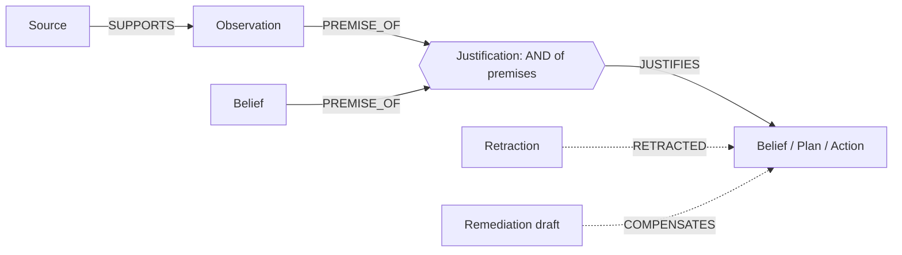

# RETCON

**Memory for AI agents that can take things back.**

**Blog post:** [The $6,000 we couldn't take back](https://dev.to/davis_philip/the-6000-we-couldnt-take-back-3c8c)
· **Code:** <https://github.com/mtrx28/retcon>
· **Built on** [FalkorDB](https://www.falkordb.com) for Graph Hacks

**Tracks:** Track 02, *Agent Memory and Coordination* (primary). Track 01, *Agents That Act on Connected Data*
(secondary: a gate stops payments whose support was retracted).

---

## The problem

An accounts-payable agent reads a vendor's web portal, which says the vendor changed bank accounts. One agent writes
that down as a note, another marks it confirmed, and the Payments agent pays an invoice of $6,000 to the new account.
Two days later you learn the portal was hacked.

Deleting the portal page from memory does almost nothing: the note, the confirmation, the payment plan and the
payment are all still there. A vector store can't help, because it never recorded *why* anything is in it.

RETCON keeps the reasons. Every memory an agent writes is stored in FalkorDB together with the memories and sources
it was derived from. When you distrust a source, RETCON retracts everything that depended on it, across all agents,
and keeps anything a second source still supports:

```
compromised portal ──► "bank = SYN-9000-5305" ──► analyst note ──► plan ──► $6,000 payment   ✗ goes OUT
        │
        └────────────► "remit address" ◄──── signed contract                                ✓ stays IN
```

Nothing is deleted: retracted memories are marked OUT and can be reinstated exactly. You can preview a retraction on a
copy of the graph before committing it. Payments that already went out land on a recall list, each with a drafted
correction that waits for a person to approve it.

---

## Run it in five minutes, no API key

**With Docker only** (simplest): from a clean clone, this starts FalkorDB, loads a small graph and serves the app.

```bash
git clone https://github.com/mtrx28/retcon.git && cd retcon
docker compose up --build
```

Open <http://127.0.0.1:8200>. More options (ports, a hosted FalkorDB) are in [docs/DEPLOY.md](docs/DEPLOY.md).

**For development** you need Docker (for FalkorDB) and Python 3.12 or newer:

```bash
git clone https://github.com/mtrx28/retcon.git && cd retcon
python -m venv .venv
source .venv/bin/activate              # Windows: .venv\Scripts\activate
python -m pip install -e ".[dev]"

python tasks.py up                     # FalkorDB in Docker (graph on :6379, FalkorDB Browser on :3000)
python tasks.py fixture                # load a 24-memory accounts-payable graph
python tasks.py demo --brain replay    # run the seeded agent day offline (replays the recorded Gemini calls)
python tasks.py ui                     # serves http://127.0.0.1:8200
```

`python tasks.py test` runs the test suite (FalkorDB must be up). If port 6379 is taken, run FalkorDB elsewhere and
set `FALKORDB_PORT`. Everything above uses an offline hashing embedder; for real semantic search, install
`python -m pip install -e ".[embed]"` and set `RETCON_EMBEDDER=minilm` (a graph must use one embedder throughout).

### The guided demo

On the front page, press **Retract** at the bottom (or open `/graph?guide=1`). Five steps, all against the real
engine:

1. **Start the agents.** Four agents read invoices, purchase orders and a vendor portal, then plan payments. The
   Payments agent picks its own tools.
2. **Preview the retraction.** The vendor portal was compromised for a week. The preview runs on a `GRAPH.COPY` fork
   and changes nothing: `1 source → 2 observations → 4 beliefs → 2 plans → 3 actions`.
3. **Retract it.** The cascade plays hop by hop. The vendor's address stays, because a signed contract also says so.
4. **Open the incident report.** `1 pending action blocked · 2 executed actions to recall · 1 kept by independent
   support`: the $6,000 payment to recall, the $34,500 payment blocked, and drafted corrections awaiting approval.
5. **Compare.** The same agents and attack with similarity search instead of the graph (a few seconds).

**Use it from your own agent.** RETCON is also a stdio MCP server with 15 tools, so Claude Code, Claude Desktop or any
MCP client can use it. Setup and a short script to try: [docs/MCP_CLIENT.md](docs/MCP_CLIENT.md).

```bash
claude mcp add retcon -e RETCON_TENANT=demo -e RETCON_EMBEDDER=hash \
  -- /full/path/to/retcon/.venv/bin/python -m mcp_server.server
```

---

## Graph data model



The one rule: **a memory is IN if at least one of its justifications has all its premises IN.** Otherwise it is
OUT. A belief backed by two independent sources has two justifications, so it survives losing one of them. Two
memories that only support each other cannot keep each other alive once their real support is gone (this is Doyle's
truth maintenance, from 1979).

| Node | What it holds |
|---|---|
| `Source` | `id, kind, trust`: a portal, a signed PDF, an ERP |
| `Observation` | what a source said, and when (`observed_at`) |
| `Belief`, `Plan`, `Action` (all labelled `Mem`) | `text`, `status` IN/OUT, `mtype` (episodic, semantic, procedural), `agent`; actions also have `tool, amount, executed` |
| `Justification` | one way a memory was derived: an AND of premises |
| `Retraction` | which source, which time window, why, who; linked to everything it flipped |
| `Remediation` | a drafted correction (bank recall, email) that needs approval |

Other edges: `FLOW` and `DEPENDS_ON` (projections for the graph algorithms), `HOLDS` (which agent knows what) and
`CONTRADICTS`. The full schema is in [docs/CONTRACT.md](docs/CONTRACT.md).

Three design rules hold everywhere: the graph decides what is IN or OUT, never a model; agents never declare where a
memory came from (whatever they retrieved before writing becomes its premises automatically); and FalkorDB is the
only database.

### Queries we depend on

These are the real queries from the code (Q1 is shortened). Syntax was checked against a running FalkorDB; notes in
[docs/SPIKE.md](docs/SPIKE.md).

**Q1, write a memory with its reasons** (`core/write/q1.py`). The memory and its justification are created in one
statement, so a memory can never exist without the edges a retraction needs.

```cypher
MATCH (a:Agent {id:$agent})
MATCH (p:Mem) WHERE p.id IN $premises
WITH a, collect(p) AS ps, all(x IN collect(p) WHERE x.status = 'IN') AS live
MERGE (m:Mem:Belief {id:$nid}) ON CREATE SET m.text=$text, m.status='OUT', m.agent=$agent, ...
SET m.status = CASE WHEN m.status = 'IN' OR live THEN 'IN' ELSE 'OUT' END
MERGE (j:Justification {id:$jid}) ON CREATE SET j.rule=$rule, j.agent=$agent, j.at=$now
MERGE (j)-[:JUSTIFIES]->(m)  MERGE (a)-[:HOLDS]->(m)
WITH m, j, ps UNWIND ps AS p
MERGE (p)-[:PREMISE_OF]->(j)  MERGE (p)-[f:FLOW]->(m) SET f.cap=$cap  MERGE (m)-[:DEPENDS_ON]->(p)
```

**Q2, retrieve only what is still believed** (`core/retrieve/q2.py`):

```cypher
CALL db.idx.vector.queryNodes('Mem','embedding',$n,vecf32($v)) YIELD node, score
WHERE node.status = 'IN' AND ($c IS NULL OR toLower(node.text) CONTAINS toLower($c))
RETURN node.id, node.text, labels(node), score ORDER BY score
```

**Q3, distrust a source for a time window** (`core/retract/cascade.py`):

```cypher
MATCH (:Source {id:$s})-[:SUPPORTS]->(o:Observation)
WHERE o.status = 'IN' AND o.observed_at >= $f AND o.observed_at <= $t
SET o.status = 'OUT', o.run = $run
```

**Q4, mark everything downstream OUT for now**, tagged with how many hops away it is:

```cypher
MATCH p = (o:Observation {run:$run})-[:PREMISE_OF|JUSTIFIES*1..40]->(x:Mem)
WHERE x.status = 'IN'
WITH x, min(length(p)) AS d
SET x.status = 'OUT', x.run = $run, x.hop = toInteger(d / 2)
```

**Q5, bring back what still has a reason**, run in a loop until it returns nothing:

```cypher
MATCH (j:Justification)-[:JUSTIFIES]->(b:Mem {status:'OUT', run:$run})
OPTIONAL MATCH (p:Mem)-[:PREMISE_OF]->(j)
WITH b, j, count(p) AS total, sum(CASE WHEN p.status = 'OUT' THEN 1 ELSE 0 END) AS dead
WHERE total > 0 AND dead = 0
WITH DISTINCT b SET b.status = 'IN', b.run = null, b.hop = null RETURN b.id
```

**Q6, list actions that already happened** (`core/recall/recall_list.py`):

```cypher
MATCH (:Retraction {id:$rid})-[:RETRACTED]->(act:Action) WHERE act.executed = true
OPTIONAL MATCH (ag:Agent)-[:HOLDS]->(act)
RETURN act.id, act.tool, act.amount, act.executed_at, ag.id
ORDER BY coalesce(act.amount, 0) DESC, act.executed_at
```

**Q7, how many sources would an attacker need to fake this?** (`core/fragility/q7.py`). The answer we use is computed
exactly from the support structure. FalkorDB's built-in max-flow gives an upper bound next to it:

```cypher
MATCH (s:Source) WITH collect(s) AS srcs MATCH (t:Mem {id:$id})
CALL algo.maxFlow({sourceNodes: srcs, targetNodes: [t], relationshipTypes: ['FLOW'], capacityProperty: 'cap'})
YIELD maxFlow RETURN maxFlow
```

Max-flow treats "needs A and B" as "A or B", so it is only exact for simple chains. The $34,500 payment in the demo
rests on one source (cost 1), but max-flow says 4. That is why the agents and the gate use the exact number. More in
[docs/FRAGILITY.md](docs/FRAGILITY.md).

**Q8, which sources to audit first, and which beliefs disagree** (`core/analytics/`):

```cypher
CALL algo.pageRank(null, 'DEPENDS_ON') YIELD node, score WHERE 'Source' IN labels(node) RETURN node.id, node.trust, score
CALL algo.WCC({nodeLabels:['Mem'], relationshipTypes:['CONTRADICTS']}) YIELD node, componentId RETURN node.id, componentId
```

**Preview** copies the tenant graph with `GRAPH.COPY`, runs the same cascade on the copy, returns the difference and
deletes the copy. The live graph is never written to (tested against real commits on random graphs).

---

## The agents, and what the model doesn't decide

There are four agents (Intake, Analyst, Comms, Payments), plus a Remediator that drafts corrections after every
retraction. A gate sits between a payment decision and the (mock) bank. It blocks an action whose premises were
retracted, and any payment over $10,000 that rests on fewer than two independent sources.

The Payments agent can choose its own tool calls with Gemini function calling. At each step it picks one of
`begin_turn`, `recall`, `remember`, `fragility`, `why`, `act` or `finish`.
The rule-based Payments agent stays as the default and as the fallback. The model never decides what is believed or whether a payment is allowed; the graph and
the gate do, and a model that tries to pay anyway is stopped. All 49 model calls from the seeded day are committed in
`data/llm_cache/payments/`, so the demo replays them offline with no key. Where the model got things wrong in earlier
runs is written up in [docs/PAYMENTS_AGENT.md](docs/PAYMENTS_AGENT.md).

---

## Results

We wrote five retraction rules and ran the same attacks through each: *delete the source*, *delete lookalikes by
similarity*, *invalidate one hop*, *taint everything downstream*, and RETCON. The first three are our own
reimplementations of how other memory systems retract (not their code).

- **Delete the source, delete lookalikes, invalidate one hop** leave most of the contamination in place (87%, 84% and
  75% on the precision scenario) and never recall a payment that already went out.
- **Taint everything downstream** removes all of it, but on the precision scenario it also wrongly flags **36 of 168
  correct payments, $1,163,150** (18 already paid), because those payments had a second, independent source.
- **Take the graph away.** Same agents, same attack, similarity search instead of justifications: it
  **retracted 3 of 9 contaminated memories and lost 5 clean ones**; with the graph, 10 of 10 and none lost. (The
  totals differ because each run is its own agent day and is scored against its own graph.)

  Whether the graph-less agents also pay the attacker depends on the embedder. With the offline `hash` embedder (what
  the guided demo uses) they paid 4,000 USD after the retraction; with the real MiniLM embedder they did not, but still
  retracted only 3 of 9 and lost 5 clean memories. So the claim is "it forgets too little and loses good memories",
  not "it always pays".

| Scenario (hash embedder) | Rule | Contamination left | Correct memories lost | Correct payments wrongly flagged |
|---|---|---:|---:|---:|
| `ap_prec_1k`: 5 poisoned vendors, 40% corroborated | delete source | 87% | 0% | 0 |
| | lookalikes | 84% | 0% | 0 |
| | one hop | 75% | 1% | 0 |
| | taint everything | 0% | 9% | **36 of 168 ($1,163,150)** |
| | RETCON | 0% | 0% | 0 |
| `science`: 40 real retractions, 2,164 memories | delete source | 84% | 0% | n/a |
| | lookalikes | 68% | 0% | n/a |
| | one hop | 7% | 0% | n/a |
| | taint everything | 0% | 1% (all 24 multi-paper topic claims) | n/a |
| | RETCON | 0% | 0% | n/a |

To reproduce: `python tasks.py bench --scenarios ap_tiny,ap_1k,ap_prec_1k,science --repeats 2` (several minutes).
Every number on the front page is read from those result files.

**Why RETCON's 0% is not a free win.** Our ground truth and RETCON use the same definition of "contaminated" (every
support path ends at a distrusted source), so a 0% could just mean we graded our own homework. What backs it up is a
second, deliberately naive implementation of the rule: RETCON has to agree with it on thousands of random graphs and
retract/reinstate sequences, and that check found two real bugs in our engine. "Contaminated" means "rests only on a
distrusted source". It does not mean "false".

**Caveats, all visible in the data:**

- On the plain scenario (`ap_1k`: one poisoned vendor, little corroboration) *taint everything* ties RETCON. The
  difference only shows up when correct payments have independent support, which the precision scenario is built to
  test. It shows the capability matters, not how often.
- In real literature most claims rest on one paper and should go, so *taint everything* loses only 1% on the science
  data. Its losses are all in the multi-paper topic claims.
- RETCON is slower than the naive rules, because it re-derives: tens of milliseconds where they take a few. The median
  is 47 ms with 9,984 memories in the graph.
- With 50 agents writing during a retraction (1,620 operations), every stored status matched an independent
  recomputation.

Method and the full list of caveats: [docs/BENCH_FRAMING.md](docs/BENCH_FRAMING.md).

### Real data: 40 retractions on their real dates

The science scenario uses 40 retracted papers from the Retraction Watch database, the papers that cite them, and
same-topic papers from OpenAlex (cell biology). Two research agents build claims from the abstracts, and each
retraction is replayed as one `distrust` on the paper's own retraction dates. All 500 contaminated memories go OUT and
none of the 1,664 supported ones are lost.

The claims are abstract sentences picked by a rule-based extractor (no LLM). On a fresh sample of 50 that the rules
were not tuned on, 4 were still not real claims. That sample was checked by a **model reviewer, not a human**; a human
pass is pending. OpenAlex also occasionally returns the wrong abstract for a paper; about 1% are flagged and reported,
not removed. Treat claim nodes as sentences, not verified facts.

---

## Limitations

- The attacker-cost number (Q7) is exact up to a size limit and an upper bound beyond it; the output says which.
- Contradiction detection is rule-based and only covers accounts payable (a vendor's bank account and address). It
  records conflicts but never changes IN/OUT.
- The "audit these sources first" ranking is a priority list, not detection. RETCON doesn't know which source is
  compromised; you tell it.
- The accounts-payable data is synthetic, and the precision scenario is constructed.
- The Payments agent's model is not fully consistent. The committed run is one where the day came out correct; the
  earlier mistakes are documented in [docs/PAYMENTS_AGENT.md](docs/PAYMENTS_AGENT.md).
- Retraction works per source and time window. It says nothing about whether a claim is true.

## Related work

Truth maintenance is an old idea (Doyle 1979, de Kleer's ATMS 1986). Graphiti/Zep invalidate an edge instead of
deleting it, but don't cascade to memories derived from it. Lineage systems such as MemLineage, CaMeL and Fides gate
future actions on where data came from, and MemTX repairs derived records and tool side effects. RETCON puts these
together on one graph database: distrusting a source for a time window across every agent, keeping independently
supported memories, an attacker-cost metric, a recall list for actions already taken, and a preview before you
commit. We read these projects' public descriptions and did not use their code.

## Data

Everything is synthetic or public. [DATA.md](DATA.md) lists each dataset, its source, licence and how to rebuild it.

- **Accounts payable:** fully synthetic, from a seeded generator (`data/generator`). Companies, vendors, invoices, bank
  accounts and emails are invented, payments go to a mock bank and emails to a sandbox inbox.
- **Science:** public data from the Retraction Watch database (via Crossref) and OpenAlex.

## Repository map

| Path | What's there |
|---|---|
| `core/` | the engine: write (Q1), retrieve (Q2), retract (Q3 to Q5), recall (Q6), fragility (Q7), analytics (Q8), preview |
| `mcp_server/` | the MCP server and its 15 tools |
| `gate/`, `core/actions.py` | the action gate and executors |
| `agents/` | Intake, Analyst, Comms, Payments (rules and Gemini), Remediator, research agents |
| `ui/` | front page, guided demo, graph view, operator console |
| `bench/`, `tests/` | the benchmark and the test suite |
| `data/` | generator, mock bank and inbox, science ingest, fixtures, recorded model calls |
| `docs/` | schema contract, fragility, MCP client guide, Payments agent, benchmark method, deployment |

---

## AI assistance

The hackathon rules ask how AI tools were used:

- **Claude Code (Anthropic)** was our coding assistant throughout. It helped design
  the contract between our two halves of the work, wrote most of the code, and assisted in reviews and testing.
- **Gemini (Google)** runs inside the product: the Payments agent can pick its tool calls with Gemini function calling
  (`gemini-3.5-flash-lite`). The recorded calls replay offline, so running the project needs no key. Only synthetic
  data is sent to the model.
- **No model is involved in retraction.** What is IN or OUT, which payments are allowed and what a retraction removes
  are all decided by graph queries and rules. The benchmark and the science claim extraction use no language model.
- The labels in the claim-extraction audit came from a model reviewer and are marked that way; a human pass is pending.
- Everything was checked by tests (property-based, differential and end-to-end). When tests caught bugs in
  AI-written code, we fixed them and kept the tests.
